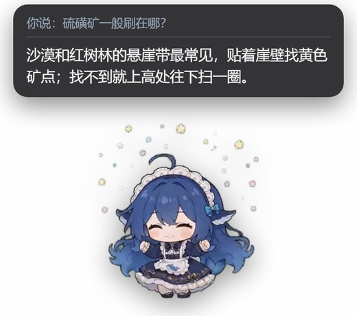

# dsh-game-copilot · DSH游戏助理

打游戏时按住一个键说话，它看一眼当前画面，把建议显示在桌宠气泡里，同时念出来——不用切出游戏、不用打字。



> Windows + DSH 环境下使用。动画素材来自上游且**禁止商用**，请以非商用方式使用，详见 `THIRD_PARTY_NOTICES.md`。

## 亮点

- **不打断游戏**：按住 Caps Lock 说话、松开就答，全程不用切窗；置顶小窗把建议显示在画面上并念出来。
- **看图能力自适应**：发一张随机数字图探测端点；答对走一步式（图 + 问题一次喂），否则退到两步式或盲答，盲答档不截图并明确说"看不到画面"。
- **语音可本地、端点自选**：ASR 走本地 faster-whisper，音频不出机器；模型可用本地 Ollama / LM Studio 完全离线，也可填云端 API。
- **隐私默认**：日志默认打码，问答原文要显式勾选才看；仓库不含 Key、问答记录与记忆文件。
- **语音与显示正交**："桌宠显示"和"语音问答"可分别开关；隐藏小窗时语音照常播报。
- **可追溯记忆 + 排障入口**：问答落本地日志，回答前按需检索最近相关记录；设置页「高级」区折叠查看日志，`plain=1` 才解封原文。
- **通用游戏**：前台窗口识别画面，不写死具体游戏，换游戏零配置。

## 前置条件

| 项 | 必需 | 说明 |
|---|---|---|
| Windows 10/11 | 是 | 全局热键、置顶小窗、系统语音依赖 Win32 |
| Python 3.10+ | 是 | 安装时勾选 **Add to PATH** |
| DSH（DeepSeek Harness） | 是 | 提供插件宿主与 HTTP 端口；先装并启动一次 |
| OpenAI 兼容模型端点 | 是 | 本地 Ollama / LM Studio / llama.cpp，或云端 API；key 只填在设置页 |
| Electron | 否 | 透明置顶小窗需要；缺失时问答与气泡仍可用，只是没有桌面小窗 |
| NVIDIA 独显 | 否 | 没有就走 CPU，功能不变只是慢；GPU 需 CUDA 12 的 cuBLAS 与 cuDNN 9 |

## 快速开始

**1. 取代码并安装**

```bash
git clone https://github.com/<你的账号>/dsh-game-copilot.git
cd dsh-game-copilot
powershell -ExecutionPolicy Bypass -File .\setup.ps1
```

脚本会建 `runtime\venv`、装依赖、落两份默认配置、把插件装进 DSH，并预下载约 464MB 的语音识别模型。已有配置不会被覆盖，重跑安全。

维护者若在 `config/release.json` 里填了 Release 模型包地址和 SHA256，脚本会优先走这个镜像并校验；留空则走 HuggingFace 官方下载。

**2. 配模型**

启动 DSH，在 **DSH 自己的设置页**里打开「桌宠参谋」分区 →「模型与能力」，填端点、模型名、API Key（本地服务一般留空），保持「自动判断」，点「测一下」。答对随机数字图即启用一步式看图；答错会自动降级。点右上角「保存设置」后立即生效。

这个配置界面就是插件内嵌进 DSH 设置页的，正常用法**不需要知道端口**。只有在你想脱离 DSH 界面、用外部浏览器打开同一份页面时，才需要端口：DSH 的 HTTP 端口是启动时动态分配的（每次重启都可能变），从 DSH 界面地址栏 `http://127.0.0.1:xxxxx/...` 里取那串数字，替换到下面地址：

```
http://127.0.0.1:<DSH端口>/dsh-game-copilot-7341/settings
```

如果 DSH 设置页里根本没有「桌宠参谋」，说明插件没挂上：检查 profile 的 `cordis.patch.yml` 挂载行，重启 DSH 后再看（见下方「配置放在哪」）。

**3. 启动**

点设置页顶部「启动游戏助理」，或双击 `start_copilot.cmd`。

| 热键 | 作用 |
|---|---|
| Caps Lock（按住） | 说话 → 松开后转写、回答、播报 |
| Ctrl+Alt+Q | 问当前画面 |
| Ctrl+Alt+W | 把剪贴板里的问题当问题问它（看图判断 + 气泡 + 语音，全屏游戏不切窗） |
| Ctrl+Alt+T | 打字提问，桌宠小窗在小人头顶弹气泡式输入条，Enter 发送 / Esc 取消（小窗没开时退回独立输入框；输入时会短暂抢焦点，全屏独占游戏仍可能退出全屏） |
| Ctrl+Alt+H | 显示 / 隐藏桌宠小窗（隐藏时语音照念） |
| Ctrl+Alt+Shift+Q | 退出 |

热键都能在设置页改，附加热键各有独立开关。文字输入两种方式：按 Ctrl+Alt+T 在小人头顶的气泡输入条打字问；或复制问题按 Ctrl+Alt+W 直接问（全程不切窗）。

## 配置放在哪

| 文件 | 管什么 |
|---|---|
| `%DSH_HOME%\dsh-game-copilot.json` | 模型端点、能力、热键、桌宠显示、TTS、记忆——设置页改的就是它 |
| `runtime\config.json` | 录音设备、音效路径、ASR 下载位置——装好后基本不用动 |

Python 侧读前者带 mtime 缓存，所以设置页改完下一句话就生效，不用重启守护。

如果你以前用过旧名 `dsh-game-pet`：安装脚本会先把旧的 `%DSH_HOME%\dsh-game-pet.json` 复制成新配置，插件与 Python 侧在新文件不存在时也会兼容读取旧文件；但要让 DSH 加载新插件，仍需把 profile 的 `cordis.patch.yml` 挂载行改成新名字（见 `plugin/cordis.patch.yml` 的说明）。

## 架构一览

四块东西靠两层接口拼起来：Node 插件（HTTP 路由、模型路由、设置页后端）、Python 守护（热键、录音、ASR、TTS、记忆）、Electron 透明小窗（气泡与动画）、DSH（宿主与端口）。截图与前台窗口识别走项目自带的 Win32/PowerShell 辅助脚本，不经过 DSH 的模型通道。

详见 `docs/设计说明.md`。想看一个具体问题的完整排查过程，见 `docs/桌宠小窗拖拽问题排查记录.md`。

## 隐私

- 仓库里没有 API Key、问答记录、记忆文件或虚拟环境；这些都由 `.gitignore` 排除。
- 设置页查看日志时，问题、回答、思考链和纯文本日志默认打码，勾选「显示原文」才解封。
- 截图只在本地生成；是否把图发给端点取决于你在设置页填的模型端点。
- 微软自然人声语音包有第三方许可，不随包分发；默认走 Edge 在线，断网落 Windows 系统语音。

## 本地测试（不用装 DSH）

```powershell
node tools\test-server.mjs
```

浏览器打开 `http://127.0.0.1:7342/`。配置读写、识图探针、音色探测、试听都是真的；「一键启动」在测试桩里只模拟，不真起进程。端口可用环境变量 `GAMEPET_TEST_PORT` 改。

## 已知取舍

- **不做全屏感知**：真独占全屏下置顶窗本来就被盖住；窗口化全屏就是普通窗口，桌宠浮着符合预期。双屏用户把小窗拖到副屏即可。
- **ASR 默认 small**：中文游戏专名识别一般，但不吃显存；换更大的模型需自行权衡显存与空闲卸载。
- **Electron 是隐藏依赖**：项目不打包 Electron；找不到时只丢透明小窗，气泡与问答链路正常。
- **动画素材禁商用**：非商用个人分享没问题，商业用途必须替换，见 `THIRD_PARTY_NOTICES.md`。

## 许可与致谢

本项目代码为 MIT，见 `LICENSE`。在 `bigk5780/dsh` 基础上二次开发；动画素材来自 `PC2005-cloud/dsh-pet`；语音识别用 `SYSTRAN/faster-whisper` 与 `Systran/faster-whisper-small`；可选语音适配器见 `THIRD_PARTY_NOTICES.md`。

维护者发布新版本、制作模型包与校验值的流程见 `docs/发布说明.md`。
